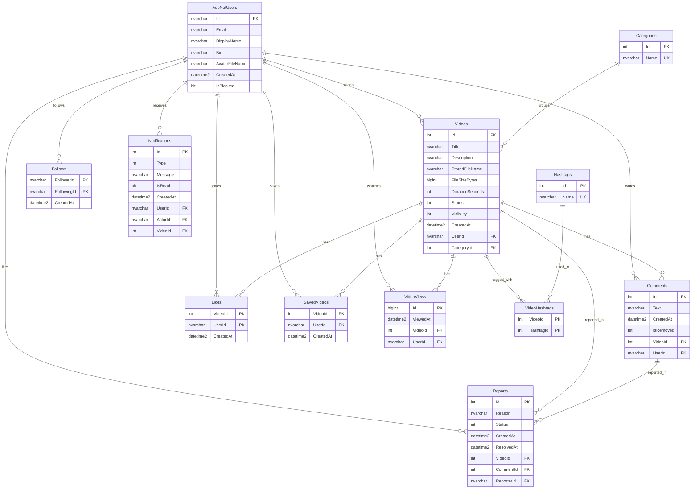

# FunSend database

The database is built Code First from `FunSendDbContext` (project
`FunSend.Data`) on MS SQL Server; LocalDB is used while developing.
`schema.sql` in this folder is the readable reference for the documentation
and is kept in step with the context by hand.

## Entity relationship diagram



## Decisions worth noting

**Users are never cascade-deleted.** A user is reachable from almost every
table, and SQL Server rejects a schema with more than one cascade path into
the same table. Every foreign key to `AspNetUsers` is therefore `NO ACTION`.
Rows that only make sense together with their video cascade from the video
instead.

**Duplicates are impossible in the database.** `Likes`, `SavedVideos`,
`Follows` and `VideoHashtags` use composite primary keys, so a second like or
a repeated follow fails before any service-layer check runs.

**Enumerations are stored as `int`** with the mapping written next to each
table in `schema.sql`.

**Moderation keeps history.** A video taken down gets `Status = Removed` and
a comment gets `IsRemoved = 1`; neither row is deleted.

**Check constraints** cover a positive duration and file size, the ban on
following oneself, and a report that targets either a video or a comment but
never both.

## Working with migrations

Run from the repository root, with `FunSend.Web` as the start-up project:

```bash
dotnet ef migrations add <Name> --project src/FunSend.Data --startup-project src/FunSend.Web
dotnet ef database update --project src/FunSend.Data --startup-project src/FunSend.Web
```
